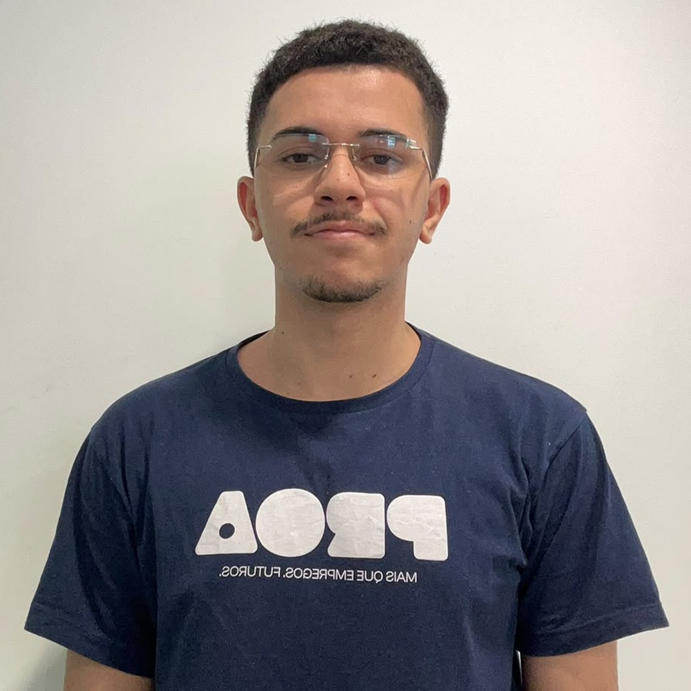
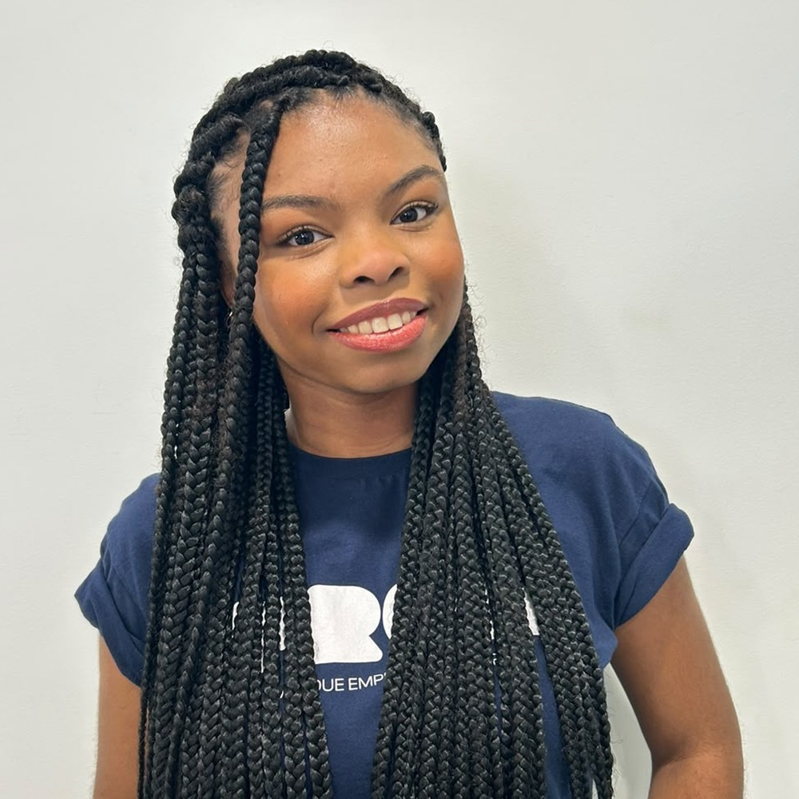
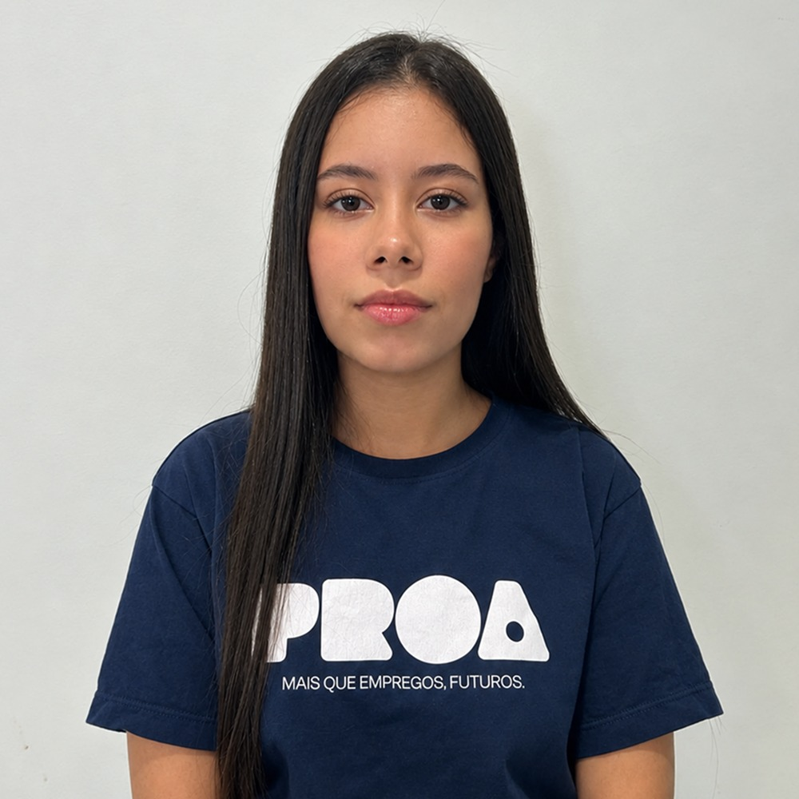
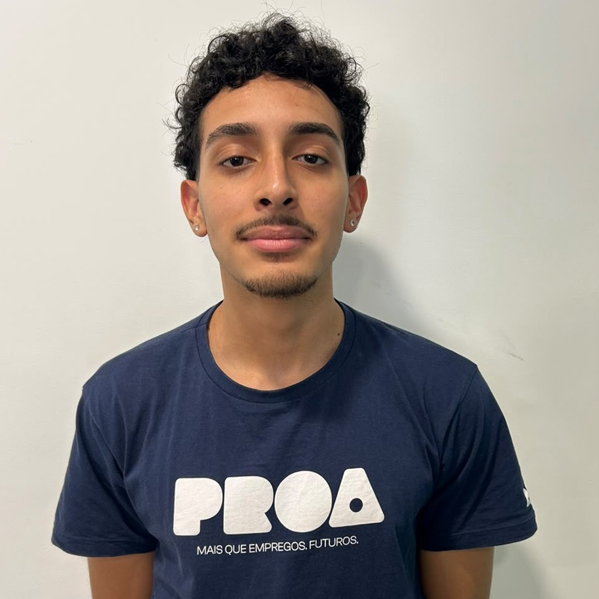
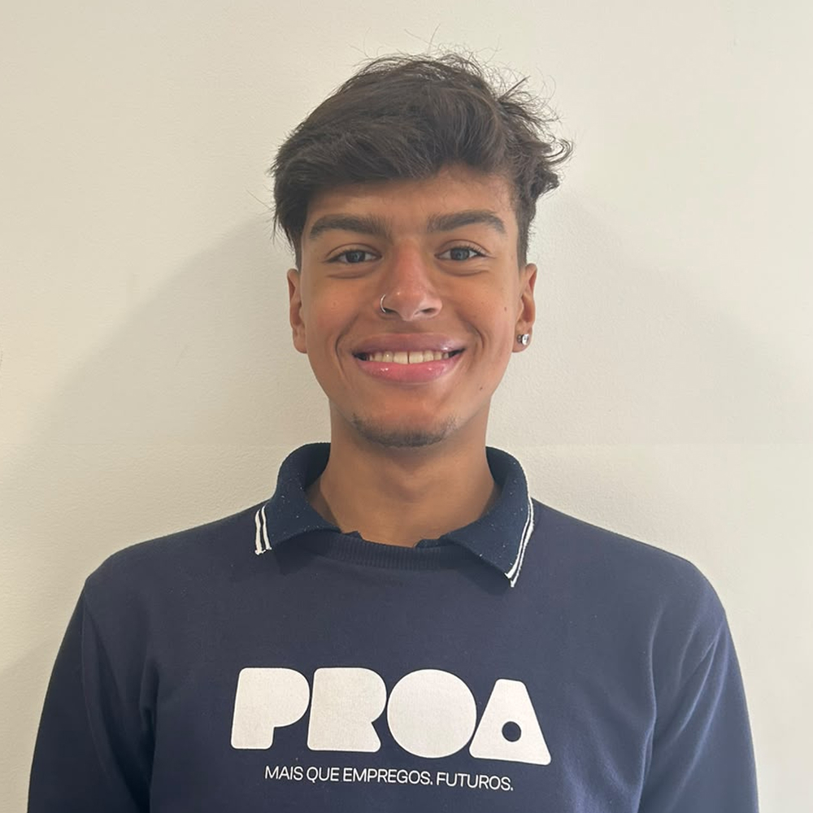

  

**Conectamos feirantes e consumidores para que o alimento da feira chegue à mesa, e não ao lixo.**

[Sobre](#quem-somos) · [O problema](#o-desperdício-na-feira-é-maior-do-que-parece) · [Funcionalidades](#funcionalidades) · [Time](#conheça-nosso-time)

## Quem somos

O **Xepa+** é um projeto acadêmico contra o desperdício de alimentos nas feiras livres e na CEAGESP, na cidade de São Paulo.

Somos estudantes que se uniram para dar um novo destino à **xepa**: os alimentos que sobram no fim da feira e que ainda estão ótimos para o consumo. O nome vem da prática em que os feirantes baixam os preços no fim do dia para vender o que sobrou.

<!-- A imagem "espaco.png" (transparente, 1 px de altura) faz todas as tabelas ocuparem a largura inteira no GitHub -->

<table>
  <tr>
    <td width="33%" valign="top">
      <h3>Missão</h3>
      <b>Dar um novo destino ao que sobra da feira.</b>  
      Reduzir o desperdício de frutas, verduras e legumes das feiras livres, conectando feirantes a consumidores e tornando esses alimentos mais acessíveis.
       
    </td>
    <td width="33%" valign="top">
      <h3>Visão</h3>
      <b>Ser referência no aproveitamento pós-feira.</b>  
      Construir um modelo sustentável, acessível e eficiente, que gere valor para consumidores, feirantes e parceiros.
       
    </td>
    <td width="33%" valign="top">
      <h3>Valores</h3>
      <b>O que guia cada decisão.</b>  
      <b>Sustentabilidade:</b> alimento bom não vira lixo. 
      <b>Acessibilidade:</b> comida de qualidade a preço justo. 
      <b>Compromisso social:</b> cuidado com quem vive da feira e com quem depende dela.
       
    </td>
  </tr>
</table>

---

## O desperdício na feira é maior do que parece

<table>
  <tr>
    <td width="33%" align="center" valign="top">
      <h3>33 mil toneladas</h3>
      de alimentos vão para o lixo por ano nas feiras da capital paulista
       
    </td>
    <td width="33%" align="center" valign="top">
      <h3>19 milhões de brasileiros</h3>
      poderiam fazer 3 refeições ao dia com esse volume
       
    </td>
    <td width="33%" align="center" valign="top">
      <h3>95% dos feirantes</h3>
      relatam desperdício no fim da feira
       
    </td>
  </tr>
</table>

  Fonte: estudo da Unesp sobre o desperdício de alimentos nas feiras livres de São Paulo.

---

 **Tecnologias utilizadas:**  

 

**Ferramentas utilizadas:**  

 

## Funcionalidades

<table>
  <tr>
    <td width="50%" valign="top">
      <h3>Para o consumidor</h3>
      <ul>
        <li>Vitrine de xepas disponíveis perto de você</li>
        <li>Mapa das feiras livres da cidade</li>
        <li>Carrinho, pagamento e histórico de pedidos</li>
        <li>Chat direto com o feirante</li>
        <li>Painel de impacto: quanto alimento você salvou</li>
        <li>Receitas para aproveitar cada alimento</li>
      </ul>
      
    </td>
    <td width="50%" valign="top">
      <h3>Para o feirante</h3>
      <ul>
        <li>Cadastro de feiras e produtos</li>
        <li>Controle financeiro de rendas e gastos, com exportação em PDF</li>
        <li>Histórico de vendas e de produtos</li>
        <li>Assistente com inteligência artificial para o dia a dia da banca</li>
        <li>Planos de assinatura</li>
      </ul>
      
    </td>
  </tr>
</table>

---

## Conheça nosso time

Estudantes de diferentes áreas com um mesmo objetivo: levar o alimento da feira à mesa, e não ao lixo.

<table>
  <tr>
    <td align="center" width="25%">
       
      <h3>Gabriel Carneiro</h3>
      Product Owner 
      Marketing  
      <a href="https://www.linkedin.com/in/gabriel-carneiro-5459b6303/">LinkedIn</a> · <a href="https://github.com/carneirogabri">GitHub</a>
       
    </td>
    <td align="center" width="25%">
       
      <h3>Jamilly Moreira</h3>
      Scrum Master 
      Vendas  
      <a href="https://www.linkedin.com/in/jamillymoreira/">LinkedIn</a> · <a href="https://github.com/milly-m-dev">GitHub</a>
       
    </td>
    <td align="center" width="25%">
       
      <h3>Fernanda Ribeiro</h3>
      Documentarista 
      Financeiro  
      <a href="https://www.linkedin.com/in/f3f3h/">LinkedIn</a> · <a href="https://github.com/f3f3h">GitHub</a>
       
    </td>
    <td align="center" width="25%">
       
      <h3>Hadson de Jesus</h3>
      Desenvolvedor 
      Vendas  
      <a href="https://www.linkedin.com/in/hadson-ferreira-068088271/">LinkedIn</a> · <a href="https://github.com/fhadson">GitHub</a>
       
    </td>
  </tr>
  <tr>
    <td align="center" width="25%">
       
      <h3>Henrique Mazza</h3>
      Desenvolvedor 
      IA  
      <a href="https://www.linkedin.com/in/henriquemazzavalle/">LinkedIn</a> · <a href="https://github.com/HenriqueMazza">GitHub</a>
    </td>
    <td align="center" width="25%">
       
      <h3>Igor Aguiar</h3>
      Desenvolvedor 
      Dados  
      <a href="https://www.linkedin.com/in/igor-aguiar-ab193132b/">LinkedIn</a> · <a href="https://github.com/Igordevice">GitHub</a>
    </td>
    <td align="center" width="25%">
       
      <h3>Matheus Barros</h3>
      Desenvolvedor 
      Dados  
      <a href="https://www.linkedin.com/in/matheus-barros-13b652330/">LinkedIn</a> · <a href="https://github.com/MatheusSouzaBarros">GitHub</a>
    </td>
    <td align="center" width="25%">
       
      <h3>Murilo Verissimo</h3>
      Desenvolvedor 
      Marketing  
      <a href="https://www.linkedin.com/in/murilo-verissimo-44a958372/">LinkedIn</a> · <a href="https://github.com/verissimoMuh">GitHub</a>
    </td>
  </tr>
</table>

---

## Agradecimentos

Às nossas famílias, aos professores e orientadores e aos feirantes que abriram suas bancas para a gente. Este projeto também é de vocês.

  Feito pelo time Xepa+ · São Paulo

